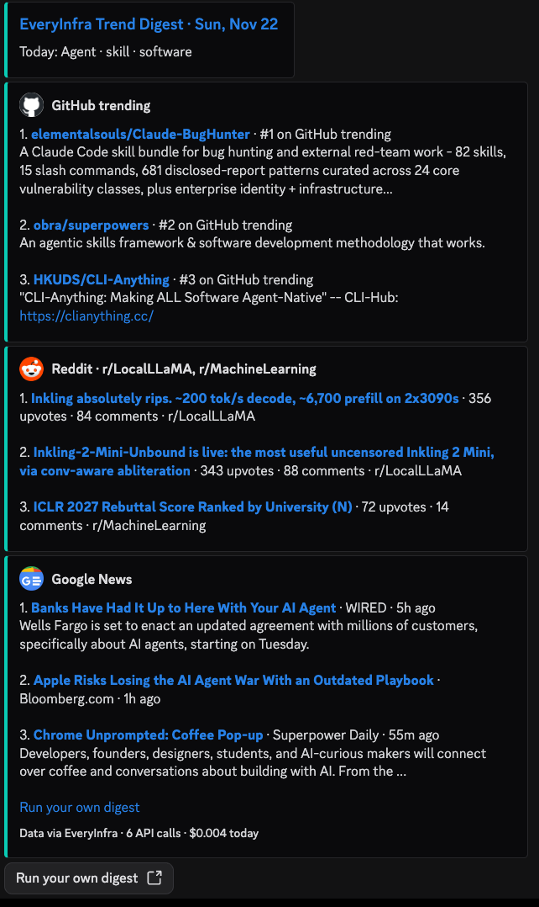

# trend-digest

A daily digest of GitHub trending repos, Product Hunt launches, Reddit posts and news, posted to
your Discord, Slack, Telegram, Feishu, DingTalk or WeCom channel by GitHub Actions. It also keeps a
web archive on GitHub Pages. Python standard library only, no server.

[中文说明](README.zh-CN.md)



Demo archive: https://everyinfra.github.io/trend-digest/

## Set it up in 5 minutes

1. Click **Use this template** > **Create a new repository** (or fork this repository).
   After a fork, open the **Actions** tab and click **I understand my workflows, go ahead and enable them**.
   GitHub turns off workflows in forks until you do this.
2. In your new repository, open **Settings > Secrets and variables > Actions > New repository secret**
   and add two secrets:
   - `EVERYINFRA_API_KEY`: sign up at https://everyinfra.com/?utm_source=github-template and create a key
     in the console. A new account can claim a $1 trial credit, valid for 24 hours, which is enough
     to try this. To keep the digest running, top up your balance. The smallest top-up is $10.
   - `DISCORD_WEBHOOK_URL`: in Discord, open the channel settings > **Integrations** > **Webhooks** >
     **New Webhook** > **Copy Webhook URL**.
3. Open **Actions > Trend digest > Run workflow**. The digest arrives in a minute or two.
   After that it runs every day at 13:00 UTC.

The `docs/` folder and `state/state.json` of this template hold the archive and the 7-day memory
of our demo. The first run in your copy deletes the demo's archive days and starts with an empty
memory, so you do not have to delete anything.

## Change what it collects

Everything is in `digest.toml`. Each `[[sources]]` entry is one API call per run, and `limit` is
how many items it may add. The digest never holds more than `max_items` (12 by default). When a
source comes back empty or short, the other sources may each add up to 2 more items until the
digest holds `min_items` (10 by default); set `min_items = 1` to turn this off.

```toml
language = "en"          # "en" or "zh"
timezone = "America/New_York"
title = "EveryInfra Trend Digest"
max_items = 12
min_items = 10

[[sources]]
use = "github/trending"
limit = 3

[[sources]]
use = "reddit/subreddit_posts"
params = { subreddit = "rust", sort = "top", date_range = "past_day" }
limit = 2

[[sources]]
use = "google_news/search"
params = { keyword = "WebAssembly", time_window = "day" }
limit = 2
```

This example is shorter than the default file. The default `digest.toml` has one GitHub source, one
Product Hunt source, two `reddit/subreddit_posts` sources and two `google_news/search` sources. To
follow another subreddit or topic, change `subreddit` or `keyword` in the entry you want.

Parameters:

| Source | `params` |
| --- | --- |
| `reddit/subreddit_posts` | `subreddit` (required). `sort`: `newest`, `popular`, `relevance`, `rising`, `top`. `date_range`: `all_time`, `past_hour`, `past_day`, `past_week`, `past_month`, `past_year`; Reddit applies it only with `sort = "top"`. |
| `google_news/search` | `keyword` (required, one or more words). `time_window`: `hour`, `day`, `week`, `month`, `year`. Also `country` and `language`. |
| `producthunt/trending` | `days`: 1 to 30. |
| `weibo/trending` | `board`: `hot`, `society`, `entertainment`, `life`, `sports`, `tech`, `acg`. |
| `twitter/trending` | `country`. |

Supported sources: `github/trending`, `producthunt/trending`, `reddit/subreddit_posts`,
`reddit/trending_posts`, `twitter/trending`, `google_news/search`, `weibo/trending`,
`douyin/trending`, `xiaohongshu/trending`. Several sources of the same platform are shown as one
section, for example `Reddit · r/LocalLLaMA, r/MachineLearning`.

`presets/zh.toml` is a Chinese setup (Weibo, Douyin, GitHub; Xiaohongshu is off by default because
it costs more). To use it, copy its content over `digest.toml`. You can also keep both files and
change the command in `.github/workflows/digest.yml` to `python -m trend_digest --config presets/zh.toml`.

An item shown in the last 7 days is not shown again. On Mondays (in your `timezone`) the digest adds
a weekly list: the repos that gained the most stars (or, when the data has no star counts, the
repos that stayed on GitHub trending for the most days) and the posts with the most comments.

To change the time, edit the `cron` line in `.github/workflows/digest.yml` on your default branch.
Cron times are UTC: `0 1 * * *` runs every day at 01:00 UTC. A minute other than 0, such as
`7 13 * * *`, avoids the busiest moment on GitHub.

A second run on the same day does not send the items of the first run again. To test with fresh
items, delete `state/state.json` first.

## Channels

Add the secrets for the channels you want. Channels without secrets are skipped.

| Channel | Secrets |
| --- | --- |
| Discord | `DISCORD_WEBHOOK_URL` |
| Slack | `SLACK_WEBHOOK_URL` (an Incoming Webhook) |
| Telegram | `TELEGRAM_BOT_TOKEN`, `TELEGRAM_CHAT_ID` |
| Feishu / Lark | `FEISHU_WEBHOOK_URL`, and `FEISHU_SECRET` if signing is on |
| DingTalk | `DINGTALK_WEBHOOK_URL`, and `DINGTALK_SECRET` if signing is on |
| WeCom | `WECOM_WEBHOOK_URL` |

Optional: set `LLM_API_KEY` to add one "Why it matters" line per item and let a model pick the
"Today:" keywords. It calls an
OpenAI-compatible `/chat/completions` endpoint, by default `https://api.everyinfra.com/api/v1`
with the model in `llm_model`. `LLM_BASE_URL` and `LLM_MODEL` change the endpoint and model.
Without `LLM_API_KEY` the digest is the same, just without those lines. Model calls are billed by
the provider of that endpoint, separately from the data calls below.

## Cost

You pay per API call. Calls that return no data are not charged. The default `digest.toml` makes
6 calls a day:

| Source | Calls per run | Price per 1,000 calls |
| --- | --- | --- |
| `github/trending` | 1 | $0.81 |
| `producthunt/trending` | 1 | $1.39 |
| `reddit/subreddit_posts` | 2 | $0.56 |
| `google_news/search` | 2 | $0.79 |

$0.81 + $1.39 + $0.56 × 2 + $0.79 × 2 = $4.90 per 1,000 runs, so $0.0049 a day and about $0.15 a
month (30 days, 180 calls).

Optional sources: `reddit/trending_posts` $0.56, `twitter/trending` $0.56, `weibo/trending` $0.56,
`douyin/trending` $0.56, `xiaohongshu/trending` $5.56 per 1,000 calls.

Current prices: https://everyinfra.com/pricing. The footer of each digest shows that day's calls
and charge.

## Web archive (GitHub Pages)

Each run writes `docs/archive/YYYY-MM-DD.html`, `docs/data/YYYY-MM-DD.json` and updates
`docs/index.html`, then commits them.

1. Open **Settings > Pages**.
2. Under **Build and deployment**, choose **Deploy from a branch**, branch `main`, folder `/docs`, and save.
3. Put the address GitHub shows (for example `https://you.github.io/trend-digest/`) into `site_url`
   in `digest.toml`, or set it as the repository variable `SITE_URL`. The messages then get a
   **Web archive** link. Platforms that have buttons show it as a button.

## Try it locally

```
python -m trend_digest --dry-run
```

`--dry-run` needs `EVERYINFRA_API_KEY` in your environment. It prints the digest and the size of
each message body, and sends and saves nothing. Python 3.11 or newer.

## Things to know

- GitHub may start scheduled runs late, from a few minutes to more than half an hour at busy times.
- In a public repository, GitHub turns off scheduled workflows after 60 days without activity.
  If the digest stops, open the Actions tab, select **Trend digest** and click **Enable workflow**.
- A webhook URL works like a password: anyone who has it can post to your channel. Keep it in
  Secrets only. If it leaks, delete the webhook in the app and make a new one, then update the secret.
- Message limits are handled for you. When a digest is too long, Telegram splits it into several
  messages, and the other channels drop the last items of the longest section. Every item stays in
  the web archive.
  - Discord: at most 10 embeds and 6,000 characters of embed text per message.
  - Slack: at most 50 blocks; a section's text at most 3,000 characters.
  - Telegram: at most 4,096 characters per message, counting the visible text after HTML tags are
    parsed. A digest that does not fit is split between items into several messages, sent in
    reading order. When a section continues in the next message, that message repeats the section's
    heading first. The link buttons are on the last message. No item is dropped.
  - Feishu: request body at most 20 KB; 100 messages a minute per bot. In the bot's security
    settings, use signature verification or none. With "custom keywords", choose a word that is
    always in the message, such as `EveryInfra`. An IP allowlist does not work, because GitHub's
    runners have no fixed address.
  - DingTalk: 20 messages a minute per bot. If you use the "custom keywords" security setting,
    choose a word that is always in the message, such as `EveryInfra`.
  - WeCom: markdown content at most 4,096 bytes, so items there have no summary line.
- Nobody is pinged. Discord messages are sent with `allowed_mentions` turned off.
- The date in the title follows `timezone` (default `America/New_York`). The run time follows the
  cron line, which is UTC.
- If one channel fails, the others still get the digest; the run is marked failed so you notice.

## Use it as a library

```python
from trend_digest import build_digest, send
from trend_digest.config import load_config

config = load_config("digest.toml")
digest = build_digest(config, api_key="...", state=None)
results = send(digest, {"discord": "https://discord.com/api/webhooks/...",
                        "telegram": {"token": "...", "chat_id": "..."}})
```

`build_digest(config, api_key=None, state=None, now=None, llm=None, fetch=None, *, kind="auto", exclude_ids=None)`

- `config`: a dict with the same keys as `digest.toml`, or the result of `load_config(path)`.
- `state`: the dict saved in `state/state.json` (7-day memory and daily snapshots), or `None`.
- `now`: a `datetime`; defaults to the current time.
- `llm`: a function that takes a prompt string and returns text, for the "Why it matters" lines.
- `fetch`: a function `(platform, action, params) -> response dict`, to replace the API calls.
- `kind`: `"auto"` (daily, plus the weekly list on Mondays), `"daily"` or `"weekly"`.
  `"weekly"` makes no API calls and raises `NotEnoughHistory` with under 2 days of snapshots.
- `exclude_ids`: item ids to leave out, on top of the 7-day memory.

It returns a dict:

| Key | Content |
| --- | --- |
| `date`, `language`, `title` | Day in your `timezone` (`YYYY-MM-DD`), `"en"` or `"zh"`, full title |
| `keywords` | Up to 3 words for "Today:" |
| `sections` | `[{"id", "label", "icon_url", "items": [...]}]` |
| `weekly` | `None`, or `{"repos", "posts", "repos_label", "start", "end", "days"}` |
| `usage` | `{"calls", "charged_usd", "failed": [{"source", "reason", ...}]}` |
| `payloads` | `{"discord": [body, ...], "slack": [...], "telegram": [...], "feishu": [...], "dingtalk": [...], "wecom": [...]}` |
| `index_entry`, `page` | Archive row, and `{"path", "html"}` of the day page |
| `state` | Updated state to save for the next run |

Each item is `{"id", "source", "title", "url", "summary", "metrics", "metric_text", "why", "extra"}`.
`metrics` is a list of `{"label", "value", "delta"}`, for example stars and the gain since yesterday.

`send(digest, targets, *, dry_run=False)` posts every body in `payloads` and returns
`[{"channel", "ok", "status", "error"}]`. Feishu and DingTalk targets can be
`{"url": ..., "secret": ...}`.

### Emit mode: build JSON, send nothing

```
python -m trend_digest --emit out.json [--config digest.toml] [--kind daily|weekly] [--seen seen.json] [--state state/state.json] [--date YYYY-MM-DD]
```

This writes the digest as JSON and does not send anything or write the web archive. Use
`--emit -` to write to stdout; logs then go to stderr.

- `--kind daily` never adds the weekly list. `--kind weekly` builds only the weekly list, on any day.
- `--seen` is a JSON array of item ids to leave out, on top of the ids in the state file.
- The state file is read and written back.

The file holds everything `build_digest` returns, plus:

| Key | Content |
| --- | --- |
| `date` | The `--date` value, or today's date in UTC |
| `kind` | `"daily"` or `"weekly"` |
| `items` | `[{"id", "platform", "url", "title"}]` for every item in the digest |
| `discord` | One Discord webhook body: `embeds`, `components`, `allowed_mentions`. Title and keywords are in the first embed. No `content`. |
| `telegram` | The body of the first Telegram message: `{"text", "parse_mode": "HTML", ...}`. Kept for callers that only read this key. |
| `telegram_parts` | The bodies of all Telegram messages, in sending order: usually one, several when the digest does not fit in one. Each has at most 4,096 visible characters. If you send to Telegram yourself, send every entry in order; sending only `telegram` drops the later messages. |
| `calls`, `cost_usd` | API calls made and the total charge in USD |
| `skipped_platforms` | Sources that failed or came back empty |

Item ids start with the source: `github:owner/repo`, `reddit:<post id>`, `producthunt:<slug>`,
`x:<trend name in lower case>`, `gnews:<first 12 hex of sha1(url)>`, `weibo:<title>`,
`douyin:<sentence id>`, `xhs:<note id>`.

Exit codes: 0 on success. 1 when every source failed or the digest is empty (no file is written,
the reason goes to stderr), or for `--kind weekly` with `not enough history for a weekly digest`.

## n8n

`n8n/` has two workflows that use only built-in n8n nodes: GitHub trending to Discord once a day,
and new posts from one subreddit to Discord every 15 minutes. See [n8n/README.md](n8n/README.md).

## License

MIT. See [LICENSE](LICENSE).
