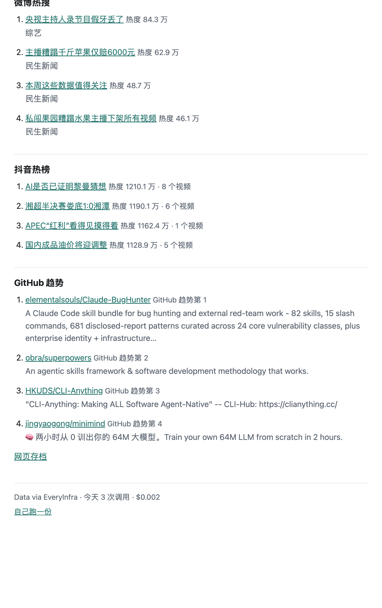

# trend-digest

每天用 GitHub Actions 汇总一份热点简报：GitHub 趋势、Product Hunt 新品、Reddit 帖子和新闻，中文版还能换成微博热搜、抖音热榜。简报推到飞书、钉钉、企业微信、Slack、Telegram 或 Discord 群里，同时在 GitHub Pages 上留一份网页存档。只用 Python 标准库，不需要服务器。

[English](README.md)



网页存档示例：https://everyinfra.github.io/trend-digest/

## 五分钟跑起来

1. 点 **Use this template** > **Create a new repository**，或者直接 fork。
   fork 的仓库要先到 **Actions** 页点 **I understand my workflows, go ahead and enable them**，GitHub 默认不运行 fork 里的工作流。
2. 在新仓库的 **Settings > Secrets and variables > Actions > New repository secret** 里加两个 secret：
   - `EVERYINFRA_API_KEY`：到 https://everyinfra.com/?utm_source=github-template 注册，在控制台创建。新账号可以领 $1 试用额度（24 小时内有效），够先跑通；要长期跑需要充值，最低充值 $10
   - 一个群的 webhook，比如飞书的 `FEISHU_WEBHOOK_URL`（各渠道要填什么见下面的表）
3. 想要中文简报（微博热搜、抖音热榜、GitHub 趋势），先把 `presets/zh.toml` 的内容复制到 `digest.toml` 里覆盖并提交。不改的话是英文简报（GitHub、Product Hunt、Reddit、新闻）。
4. 打开 **Actions > Trend digest > Run workflow** 手动跑一次，一两分钟后群里就能收到。之后每天 UTC 13:00（北京时间 21:00）自动跑。

模板仓库的 `docs/` 和 `state/state.json` 里是我们演示用的存档和 7 天去重记录。你的仓第一次运行时会删掉演示的存档页、从空记录开始，不用手动删。

## 改抓什么

只需要改 `digest.toml`。每个 `[[sources]]` 是每次运行的一次接口调用，`limit` 是这一项最多放几条，整份简报最多 `max_items` 条（默认 12）。某个来源当天没数据或不够数时，其他来源各自最多多放 2 条，把整份补到 `min_items` 条（默认 10）；不想补就写 `min_items = 1`。

```toml
language = "zh"
timezone = "Asia/Shanghai"
title = "EveryInfra 热点简报"

[[sources]]
use = "weibo/trending"
params = { board = "tech" }   # 分类榜：hot（默认总榜）、society、entertainment、life、sports、tech、acg
limit = 4

[[sources]]
use = "douyin/trending"
limit = 4

[[sources]]
use = "github/trending"
limit = 4
```

Reddit 和新闻的写法（英文默认配置里各有两条）：

```toml
[[sources]]
use = "reddit/subreddit_posts"
params = { subreddit = "LocalLLaMA", sort = "top", date_range = "past_day" }
limit = 2

[[sources]]
use = "google_news/search"
params = { keyword = "AI agents", time_window = "day" }
limit = 2
```

| 来源 | `params` |
| --- | --- |
| `reddit/subreddit_posts` | `subreddit` 必填。`sort`：`newest`、`popular`、`relevance`、`rising`、`top`。`date_range`：`all_time`、`past_hour`、`past_day`、`past_week`、`past_month`、`past_year`，只有 `sort = "top"` 时生效 |
| `google_news/search` | `keyword` 必填，可以是几个词。`time_window`：`hour`、`day`、`week`、`month`、`year`。还有 `country`、`language` |
| `producthunt/trending` | `days`：1 到 30 |
| `weibo/trending` | `board`：`hot`、`society`、`entertainment`、`life`、`sports`、`tech`、`acg` |
| `twitter/trending` | `country` |

能用的来源：`github/trending`、`producthunt/trending`、`reddit/subreddit_posts`、`reddit/trending_posts`、`twitter/trending`、`google_news/search`、`weibo/trending`、`douyin/trending`、`xiaohongshu/trending`。同一平台的几个来源会合成一段显示。

小红书热榜默认不开：每千次 $5.56，是其他来源的十倍左右。需要的话在 `presets/zh.toml` 里去掉那几行的注释。

最近 7 天出现过的条目不会重复出现。每周一（按 `timezone`）会多一份周榜：一周涨星最多的仓库（数据里没有星数时，改按上榜天数排）和评论最多的帖子。

运行时间在默认分支的 `.github/workflows/digest.yml` 里改 `cron` 一行，cron 用的是 UTC 时间：`0 1 * * *` 是每天 UTC 01:00（北京时间 09:00）。分钟写成 0 以外的数（比如 `7 13 * * *`）可以避开 GitHub 最挤的整点。

同一天再跑一次，不会重发第一次发过的条目。想用新条目重测，先删掉 `state/state.json`。

## 推送渠道

要推哪个就填哪个的 secret，没填的渠道自动跳过。

| 渠道 | 要填的 secret | webhook 在哪拿 |
| --- | --- | --- |
| 飞书 | `FEISHU_WEBHOOK_URL`；开了签名校验再加 `FEISHU_SECRET` | 群设置 > 群机器人 > 添加机器人 > 自定义机器人 |
| 钉钉 | `DINGTALK_WEBHOOK_URL`；开了加签再加 `DINGTALK_SECRET` | 群设置 > 机器人 > 添加机器人 > 自定义 |
| 企业微信 | `WECOM_WEBHOOK_URL` | 群聊右上角 > 添加群机器人 |
| Slack | `SLACK_WEBHOOK_URL` | Slack App 的 Incoming Webhooks |
| Telegram | `TELEGRAM_BOT_TOKEN`、`TELEGRAM_CHAT_ID` | 找 @BotFather 建机器人，拉进群 |
| Discord | `DISCORD_WEBHOOK_URL` | 频道设置 > 整合 > Webhook |

可选：填了 `LLM_API_KEY`，每条会多一句「为什么值得看」，「今天」后面的关键词也改由模型挑。它调用兼容 OpenAI 的 `/chat/completions`，默认地址 `https://api.everyinfra.com/api/v1`、模型取 `digest.toml` 里的 `llm_model`，可以用 `LLM_BASE_URL`、`LLM_MODEL` 换成别家。不填也能正常出简报，只是少了这一句。模型调用由那个地址的服务方另外计费，不算在下面的数据调用里。

## 费用

按调用次数计费，没取到数据的调用不收费。

中文预设（`presets/zh.toml`）每天 3 次调用：

| 来源 | 每次运行调用次数 | 每千次价格 |
| --- | --- | --- |
| `weibo/trending` | 1 | $0.56 |
| `douyin/trending` | 1 | $0.56 |
| `github/trending` | 1 | $0.81 |

合计每千次运行 $1.93，每天约 $0.002，一个月约 $0.06。

英文默认配置（`digest.toml`）每天 6 次调用：$0.81 + $1.39 + $0.56 × 2 + $0.79 × 2 = 每千次运行 $4.90，每天 $0.0049，一个月（30 天、180 次调用）约 $0.15。

其他来源每千次：`producthunt/trending` $1.39、`reddit/subreddit_posts` $0.56、`google_news/search` $0.79、`reddit/trending_posts` $0.56、`twitter/trending` $0.56、`xiaohongshu/trending` $5.56。

最新价格见 https://everyinfra.com/pricing。每份简报底部会写当天调用了几次、花了多少。

## 网页存档（GitHub Pages）

每次运行会写 `docs/archive/YYYY-MM-DD.html`、`docs/data/YYYY-MM-DD.json`，更新 `docs/index.html`，然后提交回仓库。

1. 打开 **Settings > Pages**。
2. **Build and deployment** 选 **Deploy from a branch**，分支 `main`，目录 `/docs`，保存。
3. 把 GitHub 给出的地址（比如 `https://you.github.io/trend-digest/`）填进 `digest.toml` 的 `site_url`（或者设成仓库变量 `SITE_URL`），消息里就会多一个「网页存档」链接，支持按钮的平台显示成按钮。

## 本地试跑

```
python -m trend_digest --dry-run --config presets/zh.toml
```

需要环境变量里有 `EVERYINFRA_API_KEY`。它会打印简报和每个渠道的消息大小，不发送、不保存。需要 Python 3.11 或更新版本。

## 注意事项

- GitHub 的定时任务经常晚几分钟，忙的时候能晚半小时以上。
- 公开仓库 60 天没有动静，GitHub 会停掉定时任务。简报不来了就到 Actions 页选 **Trend digest**，点 **Enable workflow**。
- webhook 地址等于密码，拿到的人都能往你的群里发消息。只放在 Secrets 里；泄露了就在群里删掉这个机器人、重新建一个，再更新 secret。
- 各家的消息上限已经处理好了：除 Telegram 外，太长时从最长那一段的末尾删条目，网页存档里条目是全的。
  - 飞书：请求体不超过 20 KB；每个机器人每分钟 100 条、每秒 5 条。安全设置选「签名校验」或不设；选「自定义关键词」的话，填一个消息里一定会出现的词，比如 `EveryInfra`；「IP 白名单」用不了，GitHub 的运行机器没有固定地址。
  - 钉钉：每个机器人每分钟 20 条。安全设置选「自定义关键词」的话，填一个消息里一定会出现的词，比如 `EveryInfra`。
  - 企业微信：markdown 内容不超过 4096 字节，所以这里每条不带摘要。
  - Telegram：每条消息不超过 4096 个字符，按去掉 HTML 标签后的可见文字算；一条放不下时，在条目之间拆成几条消息，按阅读顺序发，条目一个不删；某一段接着在下一条里继续时，下一条先重复这一段的标题，链接按钮放在最后一条。Slack：最多 50 个 block。Discord：每条最多 10 个 embed、embed 文字合计 6000 字符。
- 不会 @ 任何人。
- 标题里的日期按 `timezone` 算（不写时默认 `America/New_York`，中文预设是 `Asia/Shanghai`），运行时间按 cron（UTC）算。
- 某个渠道发送失败不影响其他渠道，但这次运行会标成失败，方便你发现。

## 当作库来用

函数签名、返回结构和只生成不发送的 `--emit` 模式，见英文 README 的 [Use it as a library](README.md#use-it-as-a-library)。

## n8n

`n8n/` 里有两个只用 n8n 内置节点的工作流：每天把 GitHub 趋势推到 Discord，每 15 分钟把某个 subreddit 的新帖推到 Discord。导入步骤见 [n8n/README.md](n8n/README.md)。

## 许可

MIT，见 [LICENSE](LICENSE)。
